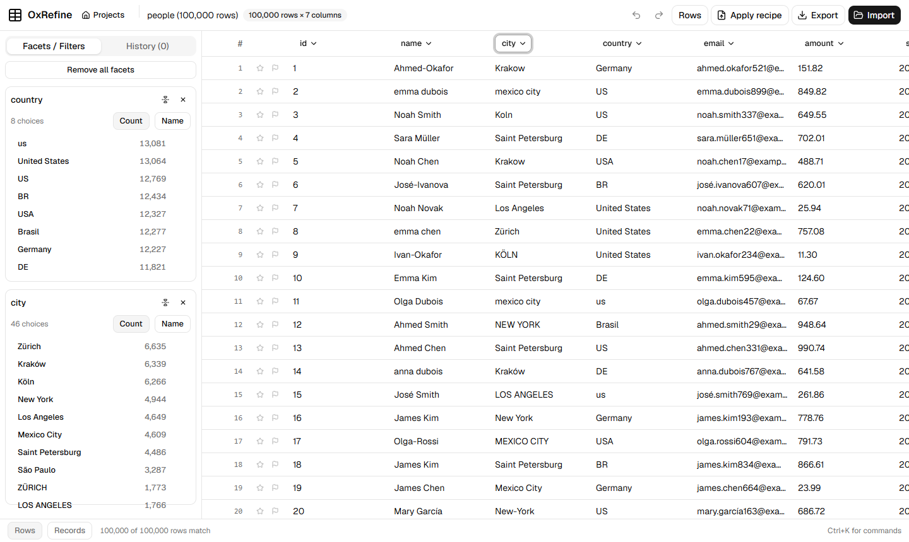

<h1 align="center">OxRefine</h1>

<p align="center">
  <b>OpenRefine's way of cleaning messy data, rebuilt in Rust.</b><br>
  Facet, cluster, transform and reconcile 100,000-row tables in milliseconds and million-row ones in under a second, with the same results as OpenRefine.
</p>

<p align="center">
  <a href="https://github.com/ilyaux/OxRefine/actions/workflows/ci.yml"></a>
  
  
  
  
</p>

<picture>
  <source media="(prefers-color-scheme: dark)" srcset="docs/screenshot-dark.png">
  
</picture>

## Why

[OpenRefine](https://openrefine.org) is the standard tool for cleaning messy tabular data, and it slows down and runs out of memory as tables grow. OxRefine keeps its workflow, its expression language and its file formats, and replaces the engine: every column is **dictionary-encoded**, so each distinct value is stored once, and transforms, facets and clustering run once per distinct value instead of once per row.

- **About 20× faster, with 10–18× less memory.** A million-row workflow takes 0.7 s instead of 16.5 s. At 2 million rows OpenRefine runs out of memory on its default heap; OxRefine needs 259 MB.
- **The same results.** Behaviour is pinned to fixtures generated from a real OpenRefine 3.10.1: 2,017 of 2,033 checks match, and each known difference is written down with its reason.
- **Your work moves both ways.** OpenRefine recipes (*Undo/Redo → Extract / Apply*) run unchanged, and whole OpenRefine projects open with their undo history. OxRefine writes projects that OpenRefine opens with every step intact.
- **Desktop, browser, server or command line.** It runs as a native desktop app, in a browser (`ox serve`, like OpenRefine), on a server or in Docker behind an access token, or headless with `ox apply`.

## Benchmark

The same workflow ran through each tool's own HTTP API: CSV import, a text facet, fingerprint clustering, a 5-step OpenRefine recipe and CSV export. Each run used a fresh process on one Windows laptop, and OpenRefine had its default 1,400 MB heap.

| Rows | OxRefine | OpenRefine | Faster | Peak RAM (OxRefine / OpenRefine) |
|---|---|---|---|---|
| 100,000 | 0.18 s | 2.6 s | 14× | 23 / 415 MB |
| 250,000 | 0.21 s | 5.1 s | 24× | 44 / 781 MB |
| 500,000 | 0.36 s | 9.0 s | 25× | 76 / 971 MB |
| 1,000,000 | 0.70 s | 16.5 s | 24× | 141 / 1,360 MB |
| 2,000,000 | 1.3 s | out of memory | | 259 MB / out of memory |

Every output cell is identical at every size (8,000,008 of 8,000,008 at a million rows). Per step at a million rows:

| Step | OxRefine | OpenRefine |
|---|---|---|
| Import | 0.43 s | 2.1 s |
| Text facet | 9 ms | 0.6 s |
| Clustering | 17 ms | 2.0 s |
| Recipe (5 operations) | 32 ms | 10.3 s |
| Export | 0.21 s | 1.6 s |

<details>
<summary>Reproducing it</summary>

Put OpenRefine 3.10.1 in `../OpenRefine/openrefine-3.10.1`, then:

```bash
cargo build --release
node benchmarks/compare.mjs            # writes benchmarks/results.json
node benchmarks/report.mjs             # turns it into benchmarks/report/index.html
```

Set `OR_MEM=4096M` to give OpenRefine more heap. There is one run per size, so steps under about 20 ms are noisy.

`node benchmarks/check.mjs --base <an older ox binary>` runs two builds through the same steps on the same machine and fails when a step is clearly slower (over 1.3× and 15 ms) or uses clearly more memory (over 1.1× and 8 MB). CI runs it on every push and pull request against the previous build.
</details>

## What it does

<picture>
  <source media="(prefers-color-scheme: dark)" srcset="docs/cluster-dark.png">
  
</picture>

- **Import:** CSV and TSV, fixed-width text, Excel (`.xlsx`, `.xls`), OpenDocument (`.ods`), JSON and JSON Lines, XML, and plain lines, from files, folders, zip/tar/gzip/bzip2 archives, the clipboard or a web address. There is a preview wizard with OpenRefine's options.
- **Explore:** text, numeric, timeline and custom facets, text filters, records mode, and a grid that stays fast at millions of rows.
- **Clean:** GREL expressions, common transforms, mass edits, splitting and joining columns and multi-valued cells, fill and blank down, transposing, fetching URLs, and `cross()` between projects.
- **Cluster:** key collision (fingerprint, n-gram, metaphone and the other phonetic keyers) and nearest-neighbour (Levenshtein) clustering, with filters on cluster size, row count and length.
- **Reconcile:** match a column against any W3C Reconciliation service, such as Wikidata or your own. You can judge candidates cell by cell or in bulk, search the service, preview entities, and add columns from the matched items.
- **Keep track:** full undo and redo, saved projects, recipes, and progress with cancel for long steps.
- **Export:** CSV and TSV, custom tabular, HTML, templating, Excel, OpenDocument, SQL, and OpenRefine projects.

## OpenRefine compatibility

Each area is checked against fixtures produced by running the same cases through OpenRefine 3.10.1. Every difference that remains is listed, with its reason, in a `known_failures.txt` next to the fixtures.

| Area | Cases matching OpenRefine |
|---|---|
| GREL expressions | 469 / 472 |
| Operations, including single-cell edits, stars, flags, transposing, fetching URLs and `cross()` | 80 / 81 |
| Facets: list, range, timeline, text, custom and records mode | 34 / 34 |
| Import options: CSV/TSV, fixed-width, Excel, ODS, JSON, XML, and zip/tar/gzip/bzip2 archives | 43 / 45 |
| Import from the clipboard and web addresses | 18 / 18 |
| Messy-data corpus: encodings, line endings, ragged rows, huge cells | 26 / 27 |
| Exports: CSV/TSV, custom tabular, HTML, templating, Excel, ODS, SQL | 14 / 15 |
| Clustering and GREL `phonetic()`: 6 keyers, Levenshtein kNN, 9 encoders × 127 values | 1,148 / 1,157 |
| Reconciliation: reconciling, judging, the operations on matches, data extension | 49 / 49 |
| OpenRefine project archives opened with their full history and written back | 136 / 136 |

## Getting started

Installers aren't available yet, so OxRefine is built from source. You need Rust (stable) and Node.js 22.

```bash
git clone https://github.com/ilyaux/OxRefine.git && cd OxRefine

# desktop app
cd ui && npm install && npm run tauri dev

# or in a browser, like OpenRefine: build the UI once and `ox serve` has it built in
cd ui && npm install && npm run build && cd ..
cargo run --release -p ox-cli -- serve           # open http://127.0.0.1:3030/
```

### On a server

```bash
# other machines get in through the link it prints, which carries an access token;
# files are uploaded from the browser and exports download to it
ox serve --host 0.0.0.0 --data /srv/oxrefine

docker build -t oxrefine .
docker run -p 3030:3030 -v oxrefine-data:/data oxrefine
```

### Headless

```bash
# replay an OpenRefine operation history on a file
ox apply history.json input.csv -o output.csv

# OpenRefine project archives work as input and output
ox apply history.json project.openrefine.tar.gz -o cleaned.openrefine.tar.gz
```

## How compatibility is checked

```bash
cargo test --release      # unit tests and every OpenRefine conformance suite
cd ui && npm run build    # UI typecheck and build
```

Each suite in `tests/<suite>/` has three files:

- `cases.mjs`: what to try.
- `gen.mjs`: runs the cases through OpenRefine 3.10.1 and writes `fixtures.json`.
- `known_failures.txt`: the deliberate differences, each with its reason.

A test fails when a new difference appears, and also when a known one starts passing, so the list only shrinks. Regenerating fixtures needs OpenRefine 3.10.1 next to the repository (see `tools/openrefine.mjs`). `node tests/orproject/check-export.mjs` opens the archives OxRefine wrote during `cargo test` in OpenRefine and checks every undo step there. CI runs all of this on Windows, macOS and Linux.

## Project layout

```
crates/ox-core   the engine: tables, import, facets, operations, GREL, clustering, reconciliation, export, history
crates/ox-cli    `ox apply` (batch) and `ox serve` (the browser app and its JSON API, UI built in)
ui/              React + shadcn/ui: virtualized grid, facets, history, and the transform, cluster and reconcile dialogs
ui/src-tauri     the desktop shell: one command that forwards to the engine
tests/           OpenRefine conformance suites and their fixtures
benchmarks/      data generator, recipe, comparison against OpenRefine, regression check, report
```

## Not yet

These aren't in OxRefine yet:

- installers and auto-update;
- RDF, MARC and wikitext import;
- the scatterplot facet;
- the PPM clustering distance;
- Python and Clojure expressions;
- OpenRefine's database, Wikibase and Google extensions;
- translations.

[ROADMAP.md](ROADMAP.md) has the full plan.

## License

MIT. OxRefine is an independent reimplementation and contains no OpenRefine code. [NOTICE](NOTICE) lists the third-party material it includes, such as the test fixtures generated with OpenRefine, the GREL function descriptions and the Apache Commons Codec rule files.
