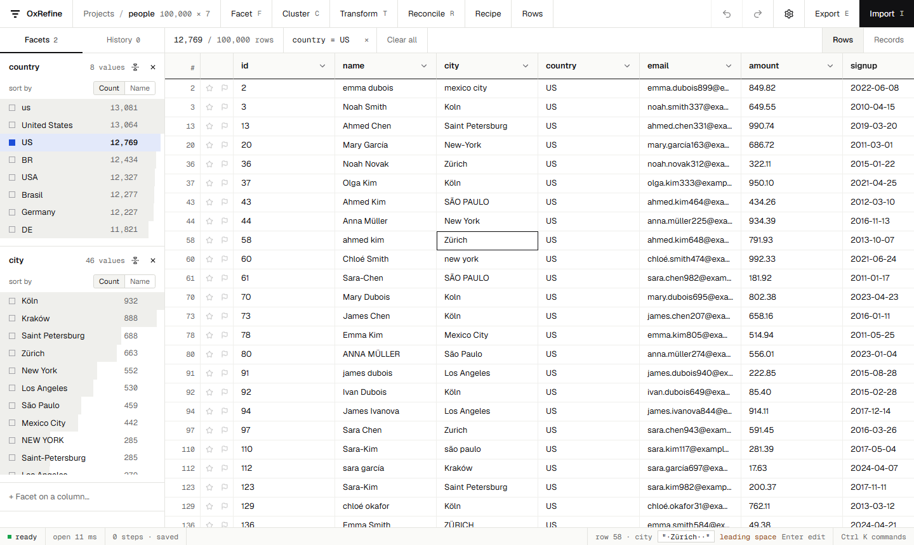

<!--
Keywords: OpenRefine alternative, Google Refine alternative, data cleaning tool, data cleansing, data wrangling,
data preparation, data quality, messy data, clean CSV, clean Excel, deduplicate data, remove duplicates,
fuzzy matching, fuzzy deduplication, clustering, record linkage, entity resolution, reconciliation, Wikidata
reconciliation, GREL, faceted browsing, data transformation, ETL, spreadsheet cleanup, large CSV files,
million rows, fast, Rust, Tauri, desktop app, self-hosted, open source, Trifacta alternative, Talend alternative
-->
<p align="center">
  
</p>

<p align="center">
  <a href="https://github.com/ilyaux/OxRefine/releases/latest"></a>
  <a href="https://github.com/ilyaux/OxRefine/actions/workflows/ci.yml"></a>
  <a href="https://ilyaux.github.io/OxRefine/"></a>
  
  
  
  
</p>

<p align="center">
  <b><a href="https://github.com/ilyaux/OxRefine/releases/latest">Download</a></b>
  &nbsp;·&nbsp; <a href="https://ilyaux.github.io/OxRefine/">Documentation</a>
  &nbsp;·&nbsp; <a href="https://ilyaux.github.io/OxRefine/moving-over.html">Coming from OpenRefine</a>
  &nbsp;·&nbsp; <a href="https://ilyaux.github.io/OxRefine/grel.html">GREL reference</a>
  &nbsp;·&nbsp; <a href="#benchmark">Benchmark</a>
</p>

<picture>
  <source media="(prefers-color-scheme: dark)" srcset="docs/src/images/screenshot-dark.png">
  
</picture>

## Why

OxRefine is a free, open-source **OpenRefine alternative** for data cleaning and data wrangling: deduplicate and fix messy CSV, Excel and JSON files, cluster near-duplicate spellings, transform columns with GREL, and reconcile values against Wikidata.

[OpenRefine](https://openrefine.org) provides the workflow this project follows. OxRefine uses a Rust engine with **dictionary-encoded** columns, storing each distinct value once per column. Value-only transforms and many facet and clustering steps can reuse work across repeated values. Row-dependent expressions and unique-value histories have different costs.

|  |  |
|---|---|
| **Measured people workflow** | At one million rows, the measured 0.6.0 candidate takes 0.66 s versus 15.02 s (22.8×), with 116 versus 1420 MiB peak working set. See the workload and candidate scope below. |
| **The same results** | Behaviour is pinned to fixtures generated from a real OpenRefine 3.10.1: 2,124 of 2,136 checks match, and each known difference is written down with its reason. |
| **Your work moves both ways** | OpenRefine recipes (*Undo/Redo → Extract / Apply*) run unchanged, and whole OpenRefine projects open with their undo history. OxRefine writes projects that OpenRefine opens with every step intact. |
| **Desktop, browser, server or command line** | A native desktop app, a browser app (`ox serve`, like OpenRefine), a server or Docker container behind an access token, or headless with `ox apply`. |

## Benchmark

**Measured 0.6.0 release candidate.** The tables and SVGs below use the frozen Windows executable with SHA beginning `31e9e0d1`. The [raw three-run report](benchmarks/release-0.6.0/openrefine-1400M.json) and [measurement verdict](benchmarks/release-0.6.0/verdict.json) retain the inputs, binary hashes and outcomes. Earlier development measurements remain in the archived reports.

Both tools ran the same people workflow through their HTTP APIs: CSV import, a text facet, fingerprint clustering, a five-operation recipe and CSV export. These are local Windows measurements with OpenRefine 3.10.1 at a fixed 1400M JVM heap. Every request used `Connection: close` in both tools; timings include connection setup and response delivery. Every completed comparison from 100k through 1M rows matched all output cells, row counts, facet choices and clusters in all three repetitions. OpenRefine exhausted that heap in all three 2M attempts, so no OpenRefine output equality or speed ratio is established there.


<details>
<summary>The measured numbers</summary>

| Rows | OxRefine | OpenRefine | Ratio | Peak working set (OxRefine / OpenRefine) |
|---|---|---|---|---|
| 100,000 | 0.09 s | 1.75 s | 19.4× | 24 / 460 MiB |
| 250,000 | 0.15 s | 3.40 s | 23.1× | 38 / 820 MiB |
| 500,000 | 0.28 s | 5.91 s | 20.9× | 64 / 986 MiB |
| 1,000,000 | 0.66 s | 15.02 s | 22.8× | 116 / 1420 MiB |
| 2,000,000 | 1.38 s | OOM at 1400M heap | — | 220 / — MiB |

At one million rows:

| Step | OxRefine | OpenRefine |
|---|---|---|
| Import | 374 ms | 1.48 s |
| Text facet | 7 ms | 646 ms |
| Clustering | 8 ms | 1.75 s |
| Recipe (5 operations) | 33 ms | 9.72 s |
| Export | 236 ms | 1.43 s |

Totals are medians of complete per-run totals; adding the phase medians can give a different number. RAM is the backend process's Windows `PeakWorkingSet64`, in MiB, excluding the parent benchmark driver, browser and database services. A JVM heap setting is not a process-RAM limit. These repeated-value workloads do not establish the same ratios for arbitrary data. Host background load was recorded rather than treated as a controlled laboratory condition.
</details>

### New: database import workload

Each backend supplied the same 100,000 SQL rows and three columns, including 1,031 NULLs. Three repetitions checked every exported row and its types. Import includes query/fetch, the typed snapshot and native project creation; source database services were local and warm. This is a workload observation, not a ranking of remote database systems.

| Backend | Median import | OxRefine import peak |
|---|---|---|
| PostgreSQL | 216 ms | 23 MiB |
| MySQL | 144 ms | 22 MiB |
| MariaDB | 148 ms | 21 MiB |
| SQLite | 115 ms | 23 MiB |

The [database report](benchmarks/release-0.6.0/database.json) retains all twelve repetitions. Every saved project reopened in a fresh backend process, with startup recorded separately and no repeated SQL query. Whole-workflow peak working set was 29 MiB for each backend; the table shows the earlier import peak. Database-server memory is excluded. OS caches remained warm.

<details>
<summary>Record a new sample</summary>

Put OpenRefine 3.10.1 in `../OpenRefine/openrefine-3.10.1`, build the current candidate, then run:

```bash
cargo build --release --locked -p ox-cli
node benchmarks/compare.mjs --runs 3 --out benchmarks/results.json 100000 250000 500000 1000000 2000000
node tools/readme-assets.mjs --input benchmarks/results.json
```

The benchmark client uses `Connection: close` equally for both engines to avoid a measured keepalive response-delivery stall. Earlier keepalive measurements are preserved separately. See the [0.6.0 protocol](benchmarks/release-0.6.0/PLAN.md) for environment, dataset and interpretation details.

The [cardinality and history workloads](benchmarks/README.md) cover low, mixed and unique transformed values, row-dependent GREL, merges, forty-step histories, undo/redo and process-restarted reopening. All their local regression gates passed. Against the official 0.5.3 binary, the people checks at the CI sizes of 250k and 1M rows also passed. The expanded 2M check still exits 1 for its recipe phase: 58 ms versus 31 ms exceeds the unchanged phase threshold. Its output checks passed; the [raw regression report](benchmarks/release-0.6.0/people-regression.json) preserves this remaining follow-up.
</details>

## What it does

<picture>
  <source media="(prefers-color-scheme: dark)" srcset="docs/src/images/cluster-dark.png">
  
</picture>

| | |
|---|---|
| **Import** | CSV and TSV, fixed-width text, Excel (`.xlsx`, `.xls`), OpenDocument (`.ods`), JSON and JSON Lines, XML, MARC, wikitext tables, PC-Axis and plain lines, from files, folders, zip/tar/gzip/bzip2 archives, the clipboard or a web address. A preview wizard with OpenRefine's options. |
| **Explore** | Text, numeric, timeline and custom facets, text filters, records mode, and a grid that stays fast at millions of rows. |
| **Clean** | GREL expressions, common transforms, mass edits, splitting and joining columns and multi-valued cells, fill and blank down, transposing, fetching URLs, and `cross()` between projects. |
| **Cluster** | Key collision (fingerprint, n-gram, metaphone and the other phonetic keyers) and nearest-neighbour (Levenshtein) clustering, with filters on cluster size, row count and length. Fingerprint suggestions in column headers highlight possible variants in the grid. |
| **Reconcile** | Match a column against any W3C Reconciliation service, such as Wikidata or your own: judge candidates cell by cell or in bulk, search the service, preview entities, and add columns from the matched items. |
| **Keep track** | Full undo and redo, saved projects, recipes, and progress with cancel for long steps. |
| **Databases** | Saved SQLite, PostgreSQL, MySQL and MariaDB connection settings, schema browsing, read-only SQL queries and a preview before project creation. Passwords stay in memory. |
| **Export** | CSV and TSV, custom tabular, HTML, templating, Excel, OpenDocument, SQL, and OpenRefine projects. |


Experimental row-code spilling is opt-in; it does not bound every allocation. See [large-file options and limits](docs/src/importing.md#big-files).

## OpenRefine compatibility

Each area is checked against fixtures produced by running the same cases through OpenRefine 3.10.1. Every difference that remains is listed, with its reason, in a `known_failures.txt` next to the fixtures.

Archives with unsupported extension data, such as Wikibase schemas or extra files, keep an untouched source copy across restarts. Exporting the current project back to OpenRefine requires unchanged data, history and metadata; the preserved original can always be exported separately. See [extension-data preservation](docs/src/moving-over.md#projects-with-additional-extension-data).


<details>
<summary>What each suite covers</summary>

| Area | Cases matching OpenRefine |
|---|---|
| GREL expressions | 561 / 561 |
| Operations, including single-cell edits, stars, flags, transposing, fetching URLs and `cross()` | 83 / 84 |
| Facets: list, range, timeline, text, custom and records mode | 39 / 39 |
| Import options: CSV/TSV, fixed-width, Excel, ODS, JSON, XML, and zip/tar/gzip/bzip2 archives | 43 / 45 |
| Import from the clipboard and web addresses | 18 / 18 |
| Messy-data corpus: encodings, line endings, ragged rows, huge cells | 26 / 27 |
| Exports: CSV/TSV, custom tabular, HTML, templating, Excel (.xlsx and .xls), ODS, SQL | 16 / 17 |
| Clustering and GREL `phonetic()`: 6 keyers, Levenshtein kNN, 9 encoders × 127 values | 1,152 / 1,159 |
| Reconciliation: reconciling, judging, the operations on matches, data extension | 49 / 49 |
| OpenRefine project archives opened with their full history and written back, metadata included | 137 / 137 |

</details>

**[Documentation](https://ilyaux.github.io/OxRefine/)**: install, [where everything is if you know OpenRefine](https://ilyaux.github.io/OxRefine/feature-map.html), [moving your projects and recipes](https://ilyaux.github.io/OxRefine/moving-over.html), and the [GREL reference](https://ilyaux.github.io/OxRefine/grel.html).

## Download

**[Get the latest release](https://github.com/ilyaux/OxRefine/releases/latest).** It includes:

- installers for Windows (`.exe` or `.msi`), macOS (universal `.dmg`) and Linux (`.AppImage`, `.deb`, `.rpm`);
- the `ox` command line for each of them.

The desktop app checks for updates when it starts and offers to install them.

## Build from source

You need Rust (stable) and Node.js 22.

```bash
git clone https://github.com/ilyaux/OxRefine.git && cd OxRefine

# desktop app
cd ui && npm install && npm run tauri dev

# or in a browser, like OpenRefine: build the UI once and `ox serve` has it built in
cd ui && npm install && npm run build && cd ..
cargo run --release -p ox-cli -- serve           # open http://127.0.0.1:3030/
```

### On a server

```bash
# other machines get in through the link it prints, which carries an access token;
# files are uploaded from the browser and exports download to it
ox serve --host 0.0.0.0 --data /srv/oxrefine

docker build -t oxrefine .
docker run -p 3030:3030 -v oxrefine-data:/data oxrefine
```

Browser pages select projects independently. If another page changes the same project, stale reads and edits are rejected and the app refreshes the view for review. The shared token grants the server user's file access; see [browser sessions and handover](docs/src/command-line.md#browser-sessions-and-handing-work-over) for concurrency and persistence limits.

`ox mcp` connects an MCP client to the same running local server: inspect projects, preview GREL, apply undoable operations and export within explicitly granted file paths. See [MCP setup and limits](docs/src/mcp.md) for Claude Desktop and Claude Code examples.

### Headless

```bash
# replay an OpenRefine operation history on a file
ox apply history.json input.csv -o output.csv

# OpenRefine project archives work as input and output
ox apply history.json project.openrefine.tar.gz -o cleaned.openrefine.tar.gz
```

## How compatibility is checked

```bash
cargo test --release      # unit tests and every OpenRefine conformance suite
cd ui && npm run build    # UI typecheck and build
```

Each suite in `tests/<suite>/` has three files:

- `cases.mjs`: what to try.
- `gen.mjs`: runs the cases through OpenRefine 3.10.1 and writes `fixtures.json`.
- `known_failures.txt`: the deliberate differences, each with its reason.

A test fails when a new difference appears, and also when a known one starts passing, so the list only shrinks. Regenerating fixtures needs OpenRefine 3.10.1 next to the repository (see `tools/openrefine.mjs`). `node tests/orproject/check-export.mjs` opens the archives OxRefine wrote during `cargo test` in OpenRefine and checks every undo step there. `node tests/orproject/extensions/check.mjs` also checks a preserved Wikibase schema and its history after a saved project is reopened. CI runs the Rust suites on Windows, macOS and Linux, and typechecks and builds the UI.

Additional [recipe-reuse fixtures](tests/recipes/sources.json) use small CC0 ecology data excerpts with authored cleanup recipes. CLI and HTTP integration tests cover changed inputs, partial failures, cancellation and saved-project restart. These scenarios supplement the compatibility totals above; unsupported Jython and Wikibase dependencies are checked for explicit errors.

## Project layout

```
crates/ox-core   the engine: tables, import, facets, operations, GREL, clustering, reconciliation, export, history
crates/ox-cli    `ox apply` (batch), `ox serve` (the browser app and its JSON API, UI built in), `ox mcp` (local stdio adapter)
ui/              React + shadcn/ui in the "Instrument" design: virtualized grid, facets, and full-window views for transform, cluster, reconcile, import, export and history
ui/src-tauri     the desktop shell: one command that forwards to the engine
tests/           OpenRefine conformance suites and their fixtures
benchmarks/      data generator, recipe, comparison against OpenRefine, regression check, report
```

## Not yet

These aren't in OxRefine yet:

- RDF import;
- the scatterplot facet;
- Python and Clojure expressions;
- Wikibase schemas and uploads, and Google Sheets integration;
- translations.

[ROADMAP.md](ROADMAP.md) has the full plan.

## License

MIT. OxRefine is an independent reimplementation and contains no OpenRefine code. [NOTICE](NOTICE) lists the third-party material it includes, such as the test fixtures generated with OpenRefine, the GREL function descriptions and the Apache Commons Codec rule files.
