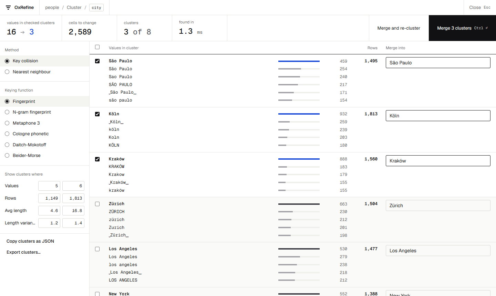

# Clustering

**Edit cells → Cluster and edit…** (or <kbd>C</kbd> on the column you last used) finds groups of different values that probably mean the same thing, and merges each group into one value you choose.

## Methods

**Key collision** turns each value into a key, and values with the same key form a cluster. The keying functions are OpenRefine's:

- **fingerprint** ignores case, accents, punctuation, word order and extra spaces;
- **n-gram fingerprint** does the same on character n-grams, which catches typos inside words;
- **metaphone3**, **cologne phonetic**, **Daitch-Mokotoff** and **Beider-Morse** group values that sound alike.

**Nearest neighbours** groups values within a distance of each other, using **Levenshtein** edit distance. The *radius* sets how far apart values can be, and the *block size* speeds up the search on large columns. The PPM distance isn't available yet.

## Working through clusters

- Each cluster lists its values with their row counts and a bar for each one's share. The most common value is suggested as the new one; click any value to use it instead.
- Tick the clusters to merge and edit the new value if needed. The strip at the top shows what that does: how many values become how many, and how many cells change. *Merge and re-cluster* keeps the view open; *Merge N clusters* (<kbd>Ctrl ↵</kbd>) merges and closes it.
- *Show clusters where* narrows the list by values in the cluster, rows, average length and length variance, each typed as a from / to pair.
- *Copy clusters as JSON* and *Export clusters* save the clusters for review elsewhere.

Each merge is one mass-edit step in the history, the same operation OpenRefine records.
