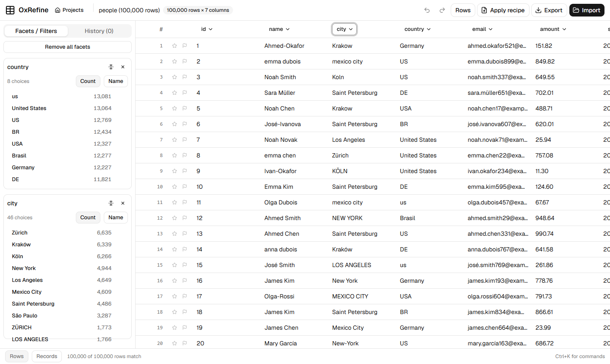

# A first cleanup

A ten-minute walk through the usual loop: import, look at the problems with facets, fix them, check the result and export it.

## 1. Import

On the home screen, choose **Import → File…** and pick a CSV, Excel, ODS, JSON or XML file. You can also paste data, give a web address, or pick a zip file or folder of files. A preview shows how the data will be read. Adjust the options if a column looks wrong (separator, header rows, encoding), then create the project.

## 2. Find the mess with facets

Open a column's menu (the arrow next to its name) and choose **Text facet**. The facet lists every distinct value with how many rows have it. Inconsistencies show up at once, such as `US`, `us`, `USA` and `United States`. Click a value to show only its rows; click more values to add them.

For numbers and dates, use **Numeric facet** or **Timeline facet**: drag the range to filter. **Text filter** finds rows by part of their text.

## 3. Fix values

- **Edit a value everywhere at once:** in a text facet, hover a choice and click the pencil. Every row with that value changes.
- **Common fixes:** use **Edit cells → Common transforms**, for example to trim whitespace, collapse spaces, change case or convert to numbers or dates.
- **Anything else:** use **Edit cells → Transform…** with a GREL expression, such as `value.replace("-", " ").toTitlecase()`. The preview shows the result for the first rows before you apply it.

## 4. Merge near-duplicates

**Edit cells → Cluster and edit…** groups spellings that probably mean the same thing, such as `São Paulo`, `Sao Paulo` and ` SÃO PAULO `. Tick the clusters to merge, adjust the new value, and choose *Merge*. Try other methods and keying functions to find more. See [Clustering](clustering.md).

## 5. Check, undo, repeat

Every step is listed in the **History** tab. Click an earlier step to go back to it; your later steps stay available until you make a new change. Facets update as you go, so you can see what is left to fix.

## 6. Export, or save the recipe

- **Export** writes the cleaned rows as CSV, TSV, Excel, OpenDocument, HTML, SQL or your own template. Only the rows that pass your facets are exported.
- **History → Extract…** saves the steps as a recipe. It is the same JSON as OpenRefine's *Extract*. Apply it to next month's file with **Apply recipe**, or from the command line with `ox apply`.
