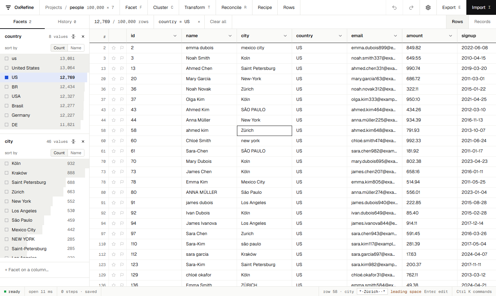

# OxRefine

OxRefine is a free, open-source tool for cleaning messy tabular data, built on [OpenRefine](https://openrefine.org)'s way of working: facet, filter, cluster near-duplicates, transform with GREL, reconcile against Wikidata, and undo anything. The engine is new and written in Rust. It is about 20 times faster than OpenRefine 3.10.1 and uses 12–22 times less memory, with the same results.

## Who it's for

- **OpenRefine users** whose tables have grown past what OpenRefine handles comfortably. Your recipes run unchanged, and your projects open with their history.
- **Anyone with messy spreadsheets:** inconsistent spellings, stray spaces, duplicates, mixed date formats, or values to match against a reference such as Wikidata.
- **Teams and servers:** run it as a desktop app, in a browser, on a server behind an access token, or headless in scripts.

## Where to start

- New to both tools? Start with [Install](install.md) and [A first cleanup](first-cleanup.md).
- Coming from OpenRefine? Read [Where everything is](feature-map.md) and [Moving projects and recipes](moving-over.md).
- Looking up a function? See the [GREL reference](grel.md).

## How close to OpenRefine is it?

Every area is checked against fixtures produced by running the same cases through a real OpenRefine 3.10.1, and 2,018 of the 2,034 checks match. The remaining differences are listed, each with its reason, in [Differences and what's missing](differences.md).
